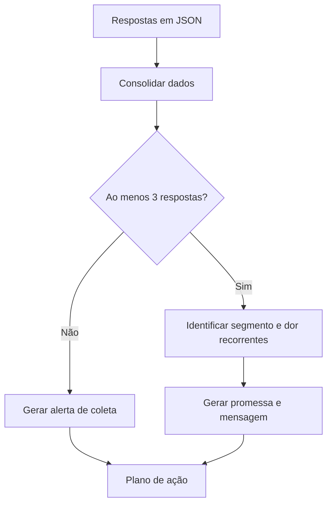

# Automatizando um processo de negócio com LangGraph e MCP

**Desafio de Projeto — Formação Avançada em Orquestração de Agentes de IA**
**Trilha:** Seu Time de Agentes em Ação
**Caso de uso:** Pesquisa de mercado e posicionamento comercial — WBM Análises

O projeto demonstra como consolidar respostas de pesquisa para identificar um segmento prioritário, uma dor recorrente e uma mensagem comercial. Os dados em `data/respostas_exemplo.json` são fictícios e servem somente para demonstração.

## Problema de negócio

Pequenos negócios e MEIs podem controlar vendas, contas e clientes em cadernos, mensagens ou planilhas dispersas. A pesquisa ajuda a identificar quais necessidades aparecem com mais frequência e a comunicar uma proposta de valor com clareza.

## Arquitetura e fluxo

- **LangGraph** consolida as respostas e verifica se a amostra atingiu o mínimo configurado.
- Com menos de três respostas, o fluxo retorna um alerta para continuar a coleta.
- Com três ou mais respostas, identifica o segmento e a dor mais frequentes e gera uma promessa e uma mensagem de abordagem.
- **MCP** expõe ferramentas para registrar uma resposta, salvar um lote e consultar respostas em `data/respostas_pesquisa.json`.

O `main.py` inicia o servidor MCP como subprocesso via stdio, consulta as respostas persistidas e, se ainda não houver nenhuma, carrega `data/respostas_exemplo.json` usando a ferramenta de gravação em lote. Em seguida, passa os dados lidos do MCP ao grafo LangGraph.



## Estrutura do projeto

```text
.
├── .devcontainer/
│   └── devcontainer.json
├── data/
│   └── respostas_exemplo.json
├── graph/
│   ├── __init__.py
│   └── workflow.py
├── mcp_server/
│   ├── __init__.py
│   └── server.py
├── .env.example
├── .gitignore
├── main.py
└── requirements.txt
```

## Executar

Requer Python 3.11 ou superior. No Codespaces, as dependências são instaladas ao criar o ambiente. Em outro ambiente:

```bash
python -m venv .venv
source .venv/bin/activate
python -m pip install -r requirements.txt
python main.py
```

No Windows, ative o ambiente virtual com `.venv\Scripts\activate`.

O comando executa dois cenários: os dados recuperados do servidor MCP e uma amostra insuficiente. Para analisar uma exportação do SurveyMars, substitua o conteúdo de `data/respostas_exemplo.json` por uma lista JSON de respostas com campos como `segmento` e `dor_relatada`.

### Servidor MCP

O cliente iniciado por `python main.py` gerencia o ciclo de vida do servidor MCP; não é necessário abrir um terminal separado. Para iniciar o servidor manualmente e conectá-lo de outro cliente:

```bash
python -m mcp_server.server
```

O servidor usa transporte stdio e disponibiliza:

- `salvar_resposta_pesquisa` (`adicionar_resposta` para compatibilidade): registra uma resposta.
- `salvar_lote_respostas`: registra várias respostas de uma vez.
- `listar_respostas_pesquisa` (`listar_respostas` para compatibilidade): retorna as respostas registradas.

O arquivo de respostas é criado quando uma gravação é feita. Para executar o pipeline integrado:

```bash
python main.py
```

## Exemplo de resultado

Com os dados fictícios incluídos, o segmento mais frequente é “Estética e salão de beleza”. O fluxo seleciona a dor mais frequente e gera uma mensagem de posicionamento com base nesses dados; isso não deve ser interpretado como uma conclusão de pesquisa real.

## Próximas evoluções

- Automatizar a importação da exportação do SurveyMars.
- Adicionar aprovação humana da mensagem antes do uso.
- Usar um modelo de linguagem para agrupar respostas abertas, com revisão dos resultados.

**Autor:** Washington Brito Miguel
